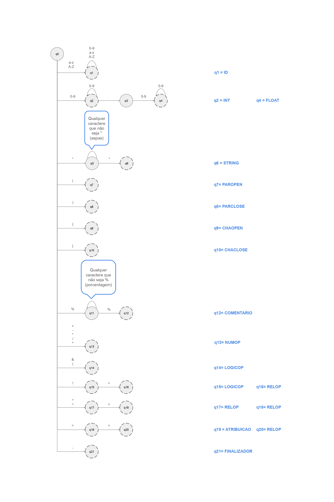
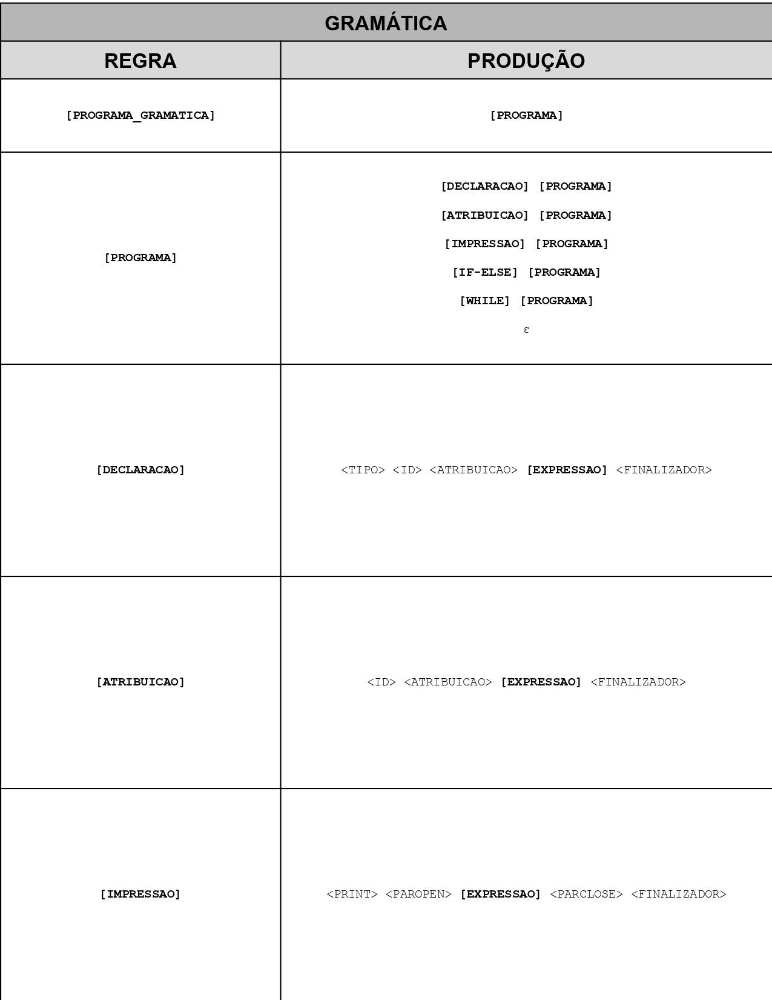
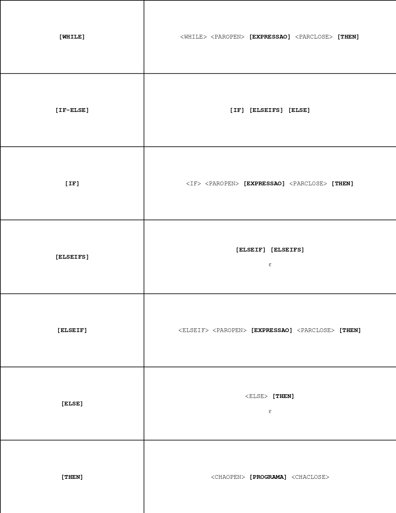
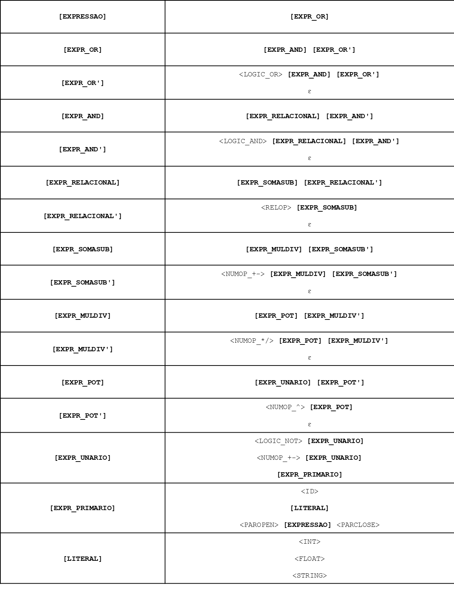

# Compilador SHODAN

Projeto acadêmico desenvolvido individualmente no 1º semestre de 2026 durante a graduação em Engenharia de Computação na UTFPR.

### Sobre o projeto

SHODAN é um compilador desenvolvido em Python para uma linguagem de programação própria, com sintaxe inspirada em linguagens imperativas e estruturadas como C.

O projeto implementa um pipeline de compilação composto por análise léxica, análise sintática preditiva LL(1), construção de Árvore Sintática Abstrata (AST), análise semântica, otimização de código e geração de código Python.

A linguagem permite declaração e atribuição de variáveis, operações aritméticas e lógicas, estruturas condicionais, laços de repetição e impressão de valores.

### Principais características

- Análise léxica baseada em autômato finito determinístico (DFA) e matriz de transições, percorrendo o código-fonte caractere por caractere para reconhecer e classificar os tokens.
- Análise sintática preditiva com parser LL(1), construído a partir da gramática da linguagem e do cálculo dos conjuntos FIRST e FOLLOW, construindo a tabela de parsing e verificando a estrutura do programa para construir a árvore sintática.
- Construção de Árvore Sintática Abstrata (AST) a partir da árvore sintática, para simplificar as estruturas e operações do programa.
- Análise semântica, mantendo uma tabela de símbolos, para verificação de declarações e compatibilidade de tipos.
- Otimização da AST, aplicando propagação de constantes e folding de constantes sobre a AST.
- Geração de código Python a partir da AST otimizada.
- Compilação e execução do código gerado.
- Tratamento de erros léxicos, sintáticos, semânticos e de execução.



### Estrutura de arquivos

```
SHODAN/
├── Parte1_Lexical/
│   ├── automato.py
│   └── lexer.py
├── Parte2_Sintatica/
│   ├── analisador_LL1.py
│   ├── tabela_parsing.py
│   ├── gramatica.py
│   ├── first.py
│   └── follow.py
├── Parte3_AST/
│   └── AST.py
├── Parte4_Semantica/
│   └── analisador_semantico.py
├── Parte5_Otimizacao/
│   └── otimizador_codigo.py
├── Parte6_Geracao/
│   └── gerador_codigo.py
└── main.py
```

### Linguagem SHODAN

A linguagem implementa os seguintes recursos:

#### Tipos de dados

- `int`: números inteiros.
- `float`: números de ponto flutuante.
- `string`: cadeias de caracteres.

#### Instruções

- Declaração de variáveis.
- Reatribuição de valores.
- Impressão de expressões com `print`.

#### Estruturas de controle

- Cadeias condicionais `if`, `elseif` e `else`.
- Laços de repetição `while`.

#### Operadores

- Aritméticos: `+`, `-`, `*`, `/` e `^`.
- Relacionais: `==`, `!=`, `<`, `<=`, `>` e `>=`.
- Lógicos: `&`, `|` e `!`.
- Unários: `+` e `-`.

#### Outros elementos

- Parênteses `(` e `)` para agrupamento e definição de precedência de expressões.
- Blocos de instruções delimitados por `{` e `}`.
- Comentários delimitados por `%`.
- Finalização de instruções com `;`.





### Exemplo de código

```
% Sequencia de Fibonacci %

int x = 10;

int a = 0;
int b = 1;
int contador = 0;

while(contador < x){
    print(a);

    int proximo = a + b;

    a = b;
    b = proximo;

    contador = contador + 1;
}
```

### Dependências

- Python 3

O projeto utiliza recursos da biblioteca padrão do Python, não exigindo bibliotecas externas para sua execução.

### Execução

Execute o compilador a partir do diretório raiz do projeto, redirecionando um arquivo .shodan para a entrada padrão. Exemplo:

```
python main.py < codigo.shodan
```

O compilador apresenta as etapas do processamento, incluindo a lista de tokens, o log da análise sintática, as árvores sintática e abstrata, a tabela de símbolos, a AST otimizada e o código Python gerado, antes de então executar o programa.
